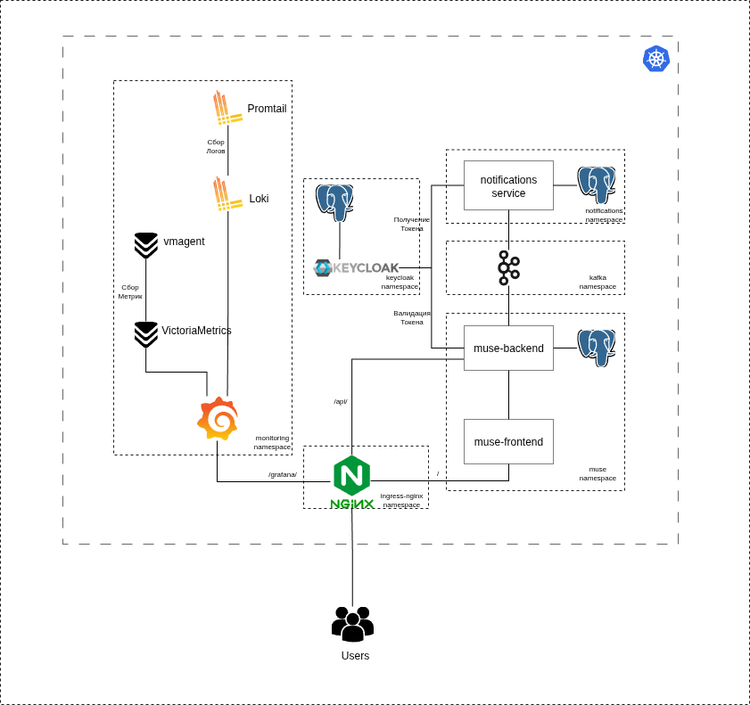

# Гайд по деплою
Пайплайны для бека и фронта находятся в соответствующих папках, они подгружаются через include в gitlab-ci.yml репозиториев с кодом. 
В values/ находятся все файлы с переменными, которые использовались для развертки хелм чартов приложения не являющихся беком и 
фронтом(постгресы, кафки и тд), команды для деплоя релиза можно взять из этих же файлов
# Деплой кафки
В данном проекте кафка работает с KRaft, а не ZooKeeper. Из-за этого наблюдается интересный баг, если указать количество реплик меньше 3,
например 1, то кафка будет пытаться подключаться к несуществующим репликам(решение проблемы не было найдено).
Параметр protocol: PLAINTEXT дает возможность не логиниться для общения с кафкой
# Деплой бека
Необходимые компоненты - postgres(values/postgres-values.yml), кафка(values/kafka-values.yml), кейклоак(values/keycloak-values.yml)
Для работы бека нужна деплойнуть постгрес(файл values/postgres-values.yml). Креды от базы для бека указываются через переменные окружения
DB_USER, DB_PASSWORD
Образы пулятся из приватного репозитория, поэтому нужно создать креды.
kubectl create secret docker-registry gitlab-registry-secret-muse-backend \
  --docker-server=it-camp.innoca.local:5005   --docker-username=< >   --docker-password=< >   --namespace=muse
Юзернеймом служит юзернейм репозитория, паролем может быть access токен с правами на чтение из регистра  
Имя секрета задается в image.pullSecrets.name

В проекте присутствует бекап базы через cronjob(файл misc/db_backup_cronjob.yml)

Для работы бека нужно поставить постгрес(values/postgres-values.yml). При параметре persistence.enabled.true бд будет сохраняться
в pvc, поэтому чтобы изменить креды можно
1. удалить pvc, накатить чарт заново, если база еще пуста
2. использовать passwordUpdateJob, для этого в passwordUpdateJob.existingSecret указать старый пароль, в auth.existingSecret новый 
3. руками подключиться к постгресу и поменяться через его командную оболочку
У работающего statefulset нельзя менять практически все настройки через хелм(например, запрашиваемые ресурсы), 
но можно попытаться изменить состояние через kubectl patch/set

# Восстановление из бекапа
Бекапы хранятся в pvc postgres-backup-pvc, который создается в misc/db_backup_cronjob.yml. 
Чтобы восстановиться:
1. Нужно поднять временный контейнер(misc/pod_with_backup.yml)
2. Запустить pg_restore
kubectl exec -it backup-copy -- pg_restore -U <имя пользователя> -d <имя бд> /tmp/<имя бекапа> -h <хост> -p <порт> -W
(kubectl exec -it backup-copy -n muse -- pg_restore -U spring -d muse /backups/ -h postgres-postgresql.muse.svc.cluster.local -p 5432 -W)

# Деплой сервиса уведомлений
Сервису уведомлений необходима развернутая кафка и постгрес(values/kafka-values.yml, values/postgres-notifications-values.yml).
Логика такая: бекенд кладет в кафку запись об уведомлении, сервис уведомлений сохраняет данные в свою бд. При появлении пользователя онлайн, ему отправляются все непросмотренные уведомления из бд(т.е. постгрес нужен для возможного долгого хранения информации об уведомлении до появления пользователя онлайн).

Длительность соединения по вебсокету устанавливается в аннотациях ингресса(metadata.annotations), стандартно это 3600 секунд, то есть через час соединение оборвется, и все непрочитанные уведомления придут снова

Создание секрета для пулла образов
kubectl create secret docker-registry gitlab-registry-secret-notifications \ 
  --docker-server=it-camp.innoca.local:5005   --docker-username=""    --docker-password=""  --namespace=notifications

Создание секрета с паролем от бд
kubectl create secret generic notifications-postgres-password --from-literal=password='' -n notifications
Имя секрета должно совпадать с тем, что было указано в auth.existingSecret при деплое постгреса(values/postgres-notifications-values.yml)

Создание секрета с чувствительными данными сервиса. В нем должны содержаться креды от почты, с которой будут идти уведомления, а также client secret, указанный в конфигурации клиента в кейклоак
kubectl create secret generic notifications-creds \
  --from-literal=mail_username=tdfyhujosfj@gmail.com \
  --from-literal=mail_password="btcf dsbz agmm fjjx" \
  --from-literal=client_secret=M11QUhkCuD5CXu72wtvql9eBDbgQbPZM \
  --namespace notifications

# Деплой фронта
Аналогично с беком нужно создать секрет с кредами
kubectl create secret docker-registry gitlab-registry-secret-muse-frontend \
  --docker-server=it-camp.innoca.local:5005   --docker-username=< >   --docker-password=< >   --namespace=muse
Имя секрета задается image.pullSecrets.name

Для настройки tls нужно создать самоподписанный сертификат и секрет для него
openssl req -x509 -nodes -days 365   -newkey rsa:2048 \
  -keyout muse-frontend.key \
  -out muse-frontend.crt \
  -config muse-frontend-openssl.cnf

kubectl create secret tls muse-frontend-tls \
  --cert=muse-frontend.crt   --key=muse-frontend.key -n muse

Имя секрета указывается в ingress.tls.secretName
# Деплой keycloak
Создание конфигмапа с конфигом реалма для кейклоак
kubectl create cm -n keycloak keycloak-realm-config \
  --from-file=realm-export.json=keycloak/users-auth-realm.json

Возможно появлении ошибки 401, в это случае стоит поработать с параметром Frontend URL (Realm settings -> General -> Frontend) или с переменной окружения KC_HOSTNAME. Возможно такая ситуация, что фронт получает токен с одним issuer, а бек будет будет обращаться с кейклоаку по другому адресу, и issuer будет стоять другой

Кейклоак не подтягивает новых пользователей или ролей из конфига при повторном импорте(ни при рестарте контейнер, ни изнутри контейнера при помощи kcadm.sh update), поэтому стоит отделить новых пользователей в отдельный файл и добавлять например через такой скрипт 
for userfile in /opt/keycloak/data/import/users/*.json; do
  /opt/keycloak/bin/kcadm.sh create users -r users-auth -f "$userfile"
done

# Деплой мониторинга  
В данном проекте используется стек VictoriaMetrics + Grafana(VM более легковесен чем Prometheus).
Монолитная версия VictoriaMetrics сама не скрейпит метрики в отличие от своего собрата, поэтому нужно также поставить vmagent, который будет это делать и, затем, отправлять метрики в vm.
Стек loki + promtail деплоится вместе через один чарт(файл loki-stack-values.yaml)
